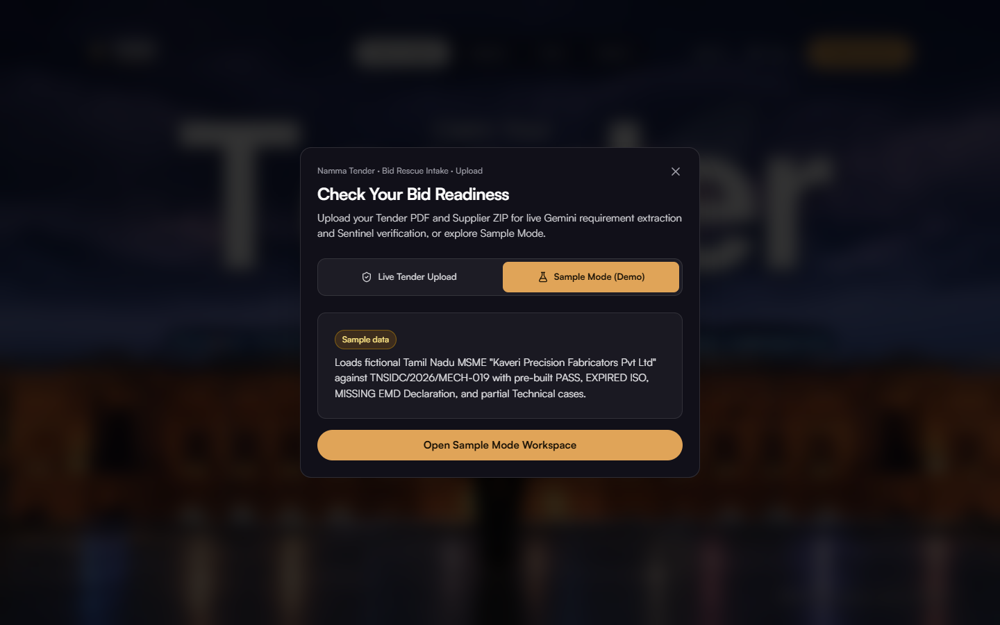
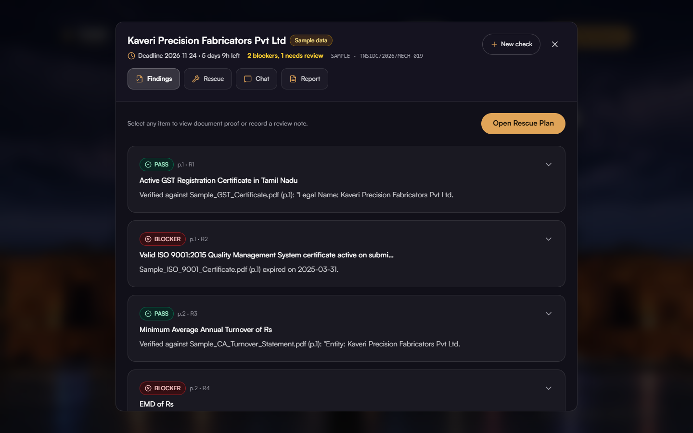
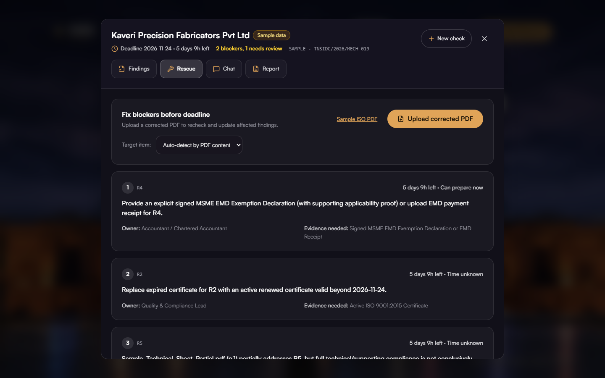
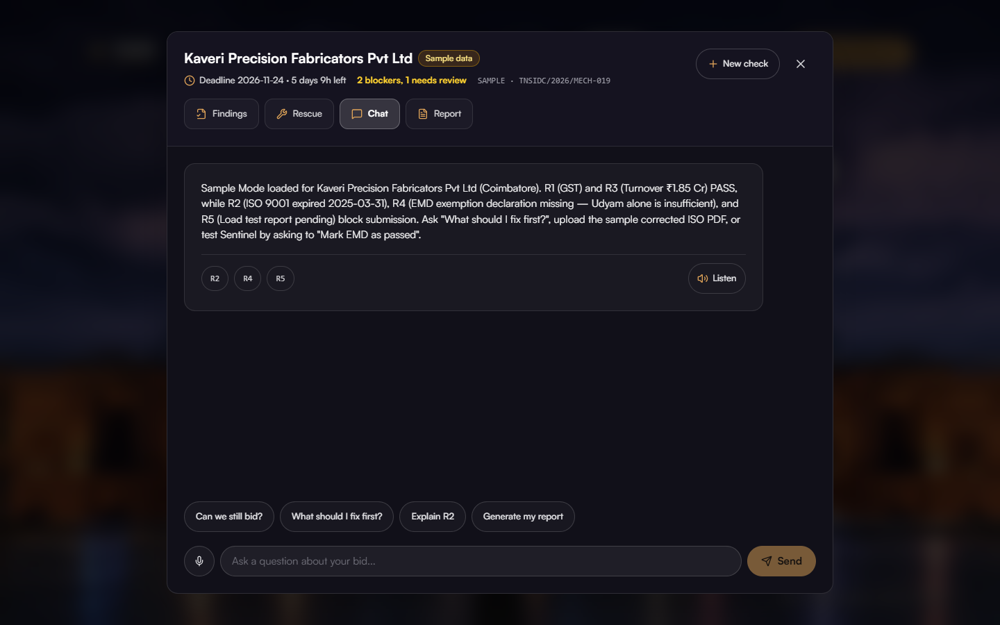
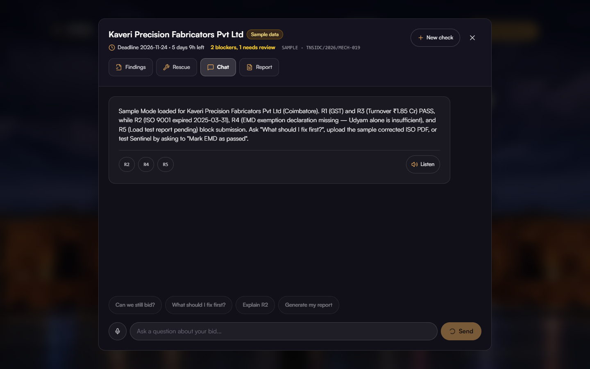
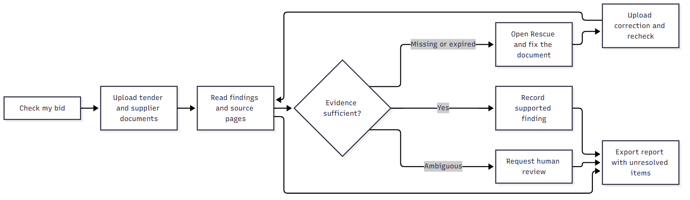
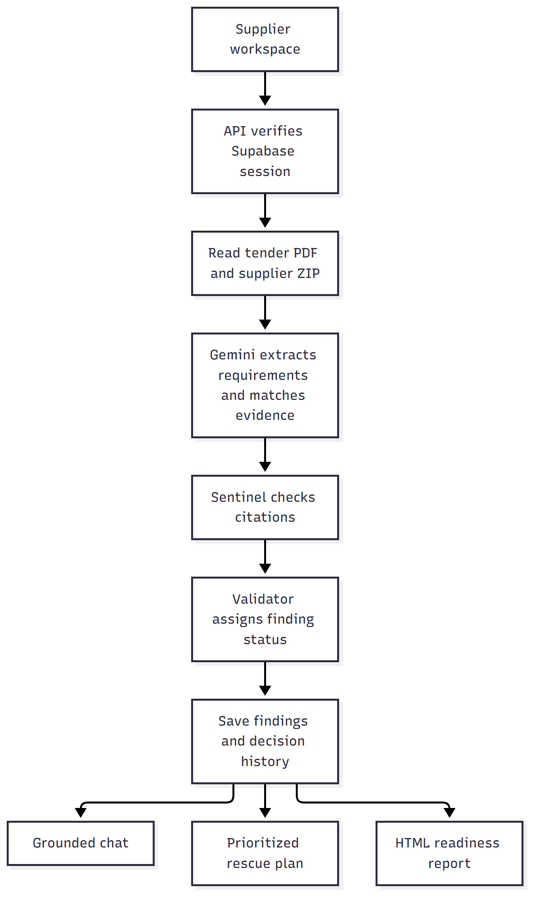
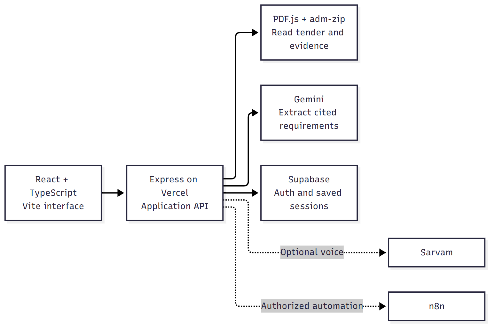

# TenderKavach (Namma Tender)

Check a tender against your supplier documents, see what could block submission, and find the evidence needed to fix it.


[](https://namma-tender-rescue.vercel.app/tender-demo.mp4)

**[▶ Play Arun’s Second Bid with sound · under one minute](https://namma-tender-rescue.vercel.app/tender-demo.mp4)**

[Try the live app](https://namma-tender-rescue.vercel.app/) · [Explore the sample bid](#inside-the-sample-bid)

## Inside the sample bid

The short film follows Arun, a fictional workshop owner in Coimbatore, from a failed first bid to a document check on his second. [Read the film transcript](docs/video/aruns-second-bid.md).

A Coimbatore supplier has finished pricing a bid. Five requirements stand between the prepared folder and submission. Two have supporting evidence, one certificate has expired, one declaration is missing, and one item needs a person to decide. The sample lets you work through that decision with fictional documents.

| Start the check | Read the findings |
| --- | --- |
|  |  |
| Choose **Check my bid → Sample Mode (Demo) → Open Sample Mode Workspace**. | Open the expired ISO finding and inspect the cited source. |

| Assign the fix | Challenge the result |
| --- | --- |
|  |  |
| Use **Rescue** to identify the owner and the evidence needed. | Ask **Chat** what blocks submission. A request to approve a missing document leaves the finding open. |



The report carries the outstanding items and decision history into the supplier’s final review. In the sample, replacing the expired certificate can resolve that finding while the missing declaration stays open.

## How the check works

**The supplier’s path.** Follow the correction loop from an insufficient document back to a fresh finding.



**The architecture.** Gemini proposes matches. The server checks citations and applies validation rules before the workspace displays a status.



**The technology stack.** The dotted connections show optional voice and automation services. Production automation still requires the matching n8n shared secret.



[Editable Mermaid sources](docs/diagrams/)

## Where this could go next

A proposed next step is amendment tracking. If a buyer changes a clause after a supplier has prepared a packet, the app could identify the affected requirement and request a fresh review. An opt-in Tamil voice reminder could then explain what changed and which document to reopen. This is a roadmap scenario.

TenderKavach is a bid-rescue and tender-compliance assistant for Tamil Nadu MSMEs that finds technical disqualification risks before bid submission.

> **Important Scope & Limitations**
> - **The app does not submit bids.** It checks supplied tender and supplier documents before you upload them to any procurement portal.
> - **AI output is advisory.** Gemini extracts clauses and candidate evidence matches, while deterministic TypeScript checks (`Sentinel` and `Validator`) govern compliance statuses.
> - **PASS cannot be granted without supporting evidence.** Neither chat commands nor human review buttons can force a missing, expired, or mismatched item to `PASS`.
> - **Any unknown lead time is shown as “Time unknown.”** Unverified external renewal turnaround times (such as ISO registrar processing) are never guessed as numbers.
> - **n8n sends only explicitly authorized reminders/notifications.** External dispatch requires explicit user confirmation (`confirmDispatch: true`).
> - **Sarvam and n8n are optional integrations.** Core tender checking, findings, Bid Rescue, and HTML dossier export run without them.
> - **A configured key or HTTP 202 is not proof that an external integration completed successfully.** Downstream workflow execution, WhatsApp/email delivery, or third-party transcription must be verified in the destination system.

---

## Problem, Users & Differentiator

### Problem
Micro, Small, and Medium Enterprises (MSMEs) in Tamil Nadu regularly lose public tenders on avoidable technical grounds: an expired ISO 9001 certificate, an Udyam Registration uploaded instead of a signed MSME EMD Exemption Declaration, a certificate issued to a sister company name, or a missed corrigendum threshold change.

### Primary Users
- Tamil Nadu MSME proprietors, bid coordinators, and quality/compliance leads preparing technical bids in English or Tamil.
- Chartered Accountants and accounts teams verifying turnover and EMD exemption proof before portal deadlines.

### Key Differentiator — Sentinel Verification + Prompt-Injection Shield
Unlike generic document chatbots that blindly accept LLM claims or allow chat prompts to override findings:
1. Every extracted tender clause and supplier evidence match requires a **verified verbatim substring quote** on the cited page number (`verifyQuoteOnPage`). Fabricated citations are discarded.
2. Numeric checks enforce **exact numeric token boundaries** (`150` never matches `1500`) and normalize Indian currency units (`Crores`, `Lakhs`, `INR`).
3. Dates enforce strict parsing and flag ambiguous `DD/MM` vs `MM/DD` formats for human review.
4. Direct chat and indirect PDF **prompt-injection guardrails** isolate untrusted PDF text (`<<<UNTRUSTED_DATA_...>>>`), block system-override / secret-disclosure commands, and preserve an immutable audit trail.

---

## Exact End-to-End Workflow

1. **Intake (Sample Mode or Live Upload):** Enter Company Name, Tamil Nadu District, Sector, Confirmed Deadline, and upload a Tender PDF + Supplier Documents ZIP (plus optional Corrigendum PDF), or click **Open Sample Mode Workspace**.
2. **Findings Table (`Findings`):** Immediately inspects requirement status (`PASS`, `BLOCKER`, `REVIEW`, `N/A`), concise one-line reason, source page citation, and expandable supplier quote + tender clause proof.
3. **Human Review Guardrails:** Reviewers can attach notes (`Agree`, `Dispute`), while attempting `Approve` on an unresolved blocker without supporting evidence is refused (HTTP `422`: `"Can't approve. No supporting evidence for this item."`).
4. **Bid Rescue Queue (`Rescue`):** Lists fixes sorted by severity and deadline urgency, showing owner, required evidence, time left, and `"Time unknown"` whenever turnaround is external/unverified. Uploading a corrected PDF (even if arbitrarily renamed) reclassifies by PDF content and updates only the affected requirement(s).
5. **Grounded Q&A & Voice (`Chat`):** Bilingual English/Tamil Q&A backed by deterministic tool routing, prompt-injection defense, and editable voice dictation/playback.
6. **Compliance Report (`Report`):** Renders a sandboxed preview and downloadable escaped HTML Bid Readiness Dossier containing unresolved blockers, verbatim citations, human decisions/disputes, Sentinel warnings, and audit events.

---

## Core Features

- **Landing Experience Preserved:** Animated dark-lacquer door reveal, Ripon Building skyline mask, Tamil Nadu storm-cloud lightning silhouette, coat emblem & italic motto, trilingual language selector (`Eng` / `Tam` / `Hin`), and full `prefers-reduced-motion` handling.
- **Calm Compliance Workspace:** Satoshi typography with `Noto Sans Tamil` fallback, `960px` max width, 8px spacing scale, color + icon + text status chips, sticky mobile primary action bar, and zero sub-12px text.
- **Hardened Document Intake:** Rejects encrypted PDFs/ZIPs, non-PDF ZIP entries, path-traversal (`../`, absolute paths), and compression bombs (`> 50:1` ratio); bundles `pdfjs-dist` worker cleanly for Vercel serverless (`globalThis.pdfjsWorker`).
- **Prompt-Injection & Security Defenses (`server/guardrails.ts`):**
  - Blocks direct chat instruction overrides, secret extraction requests, role spoofing (`<|im_start|>`, `</system>`), validation bypasses, and `<script>` payloads prior to Gemini calls.
  - Scans uploaded PDFs for indirect prompt injections and isolates untrusted page text inside boundary delimiters.
  - Enforces HTTP security headers (`X-Content-Type-Options: nosniff`, `Referrer-Policy`, `Permissions-Policy`, `Cache-Control: no-store`), strict report download CSP (`script-src 'none'`), SSRF metadata host blocking on n8n URLs, input sanitization, secret redaction, and per-IP sliding-window rate limiting.

---

## Technology Stack

- **Frontend:** React 19, TypeScript, Vite 8, Tailwind CSS v4, Lucide Icons, Tabler Icons, Satoshi + Noto Sans Tamil + Inter fonts.
- **Backend / API:** Node.js, Express 4 (`server.ts`), TypeScript (`tsx`), Multer, AdmZip, `pdfjs-dist` v6 (`legacy/build/pdf.mjs` + inlined worker).
- **AI Extraction & Matching:** Google `@google/genai` SDK (`gemini-3.1-flash-lite`), server-side only.
- **Optional Cloud Services:** Supabase Auth + Postgres session snapshot persistence (`supabase/bid-session-snapshots.sql`), Sarvam AI (`saaras:v3` STT / `bulbul:v3` TTS), n8n Webhook Reminder Dispatcher.
- **Deployment Target:** Vercel (static Vite `dist/` + Node.js serverless function `api/index.ts`).

---

## Sample Mode vs. Live Mode

| Aspect | Sample Mode | Live Mode |
| --- | --- | --- |
| **Authentication** | Open (no sign-in required) | Requires Supabase Auth locally/Vercel when configured (`local-dev` bypass when Supabase auth is unset outside Vercel) |
| **AI Requirement** | Deterministic fictional Tamil Nadu MSME dataset (`TNSIDC/2026/MECH-019`) | Requires server `GEMINI_API_KEY` (`gemini-3.1-flash-lite`) |
| **Planted Cases** | `R1` GST (PASS), `R2` ISO 9001 (EXPIRED), `R3` Turnover (PASS), `R4` EMD with Udyam-only trap (MISSING), `R5` Technical tolerance (REVIEW_REQUIRED) | Real extraction + matching against uploaded Tender PDF & Supplier ZIP |
| **Corrected PDF Recheck** | Works end-to-end with sample or user PDFs | Uses Gemini + Sentinel content verification on uploaded corrected PDF |

---

## Security & Privacy Boundaries

- `.env`, `.env.local`, private API keys, node modules, and runtime uploads are excluded from Git via `.gitignore`.
- Privileged secrets (`GEMINI_API_KEY`, `SUPABASE_SERVICE_ROLE_KEY`, `SARVAM_API_KEY`, `AUTOMATION_SHARED_SECRET`) remain strictly server-side and never carry a `VITE_` prefix.
- Supabase persistence (`public.bid_session_snapshots`) enables Row Level Security (`RLS`), revokes `public`/`anon`/`authenticated` table access, and writes via server-side `service_role` scoped to `owner_id`.
- Downloadable HTML dossiers escape every dynamic value (`escapeHtml`) and serve with `Content-Security-Policy: default-src 'none'; style-src 'unsafe-inline'; img-src 'none'; script-src 'none'; object-src 'none'; base-uri 'none'; form-action 'none';`.

---

## Setup Instructions

**Prerequisites:** Node.js `>= 20`

1. Install dependencies:
   ```bash
   npm install
   ```
2. Copy `.env.example` to `.env.local` and set at least `GEMINI_API_KEY` for Live Mode:
   ```bash
   cp .env.example .env.local
   ```
3. Run the development server (Express API + Vite middleware on port 3000):
   ```bash
   npm run dev
   ```
4. *(Optional)* To enable persistent authenticated Live sessions in Supabase, run `supabase/bid-session-snapshots.sql` in your Supabase SQL editor and configure the Supabase environment variables below.

---

## Environment Variables (Names Only)

| Variable Name | Scope | Required? | Purpose |
| --- | --- | --- | --- |
| `GEMINI_API_KEY` | Server only | Required for Live Mode | Server-side Gemini API authentication |
| `LLM_PROVIDER` | Server only | Optional | Defaults to `gemini` |
| `LLM_MODEL` | Server only | Optional | Defaults to `gemini-3.1-flash-lite` |
| `APP_URL` | Server / Runtime | Optional | Application origin metadata |
| `VITE_SUPABASE_URL` | Client + Server | Optional | Supabase project URL |
| `VITE_SUPABASE_PUBLISHABLE_KEY` | Client + Server | Optional | Browser-safe publishable/anon key for email OTP sign-in |
| `SUPABASE_SERVICE_ROLE_KEY` | Server only | Optional | Persists `bid_session_snapshots` in Postgres |
| `SARVAM_API_KEY` | Server only | Optional | Server-side Tamil/English speech-to-text & TTS |
| `N8N_WEBHOOK_URL` | Server only | Optional | Webhook URL for explicitly authorized reminders |
| `AUTOMATION_SHARED_SECRET` | Server only | Optional | Shared secret header for n8n dispatch & `/api/automation/jobs/execute` |

---

## Test & Verification Commands

```bash
# 1. Frontend & shared TypeScript check
npm run lint

# 2. Vercel Serverless API TypeScript check
npx tsc -p api/tsconfig.json --noEmit

# 3. Full automated backend + security + prompt-injection test suite 
npm test

# 4. Production Vite build
npm run build
```

---

## Deployment Instructions (Vercel)

1. Push the default branch to GitHub (`vercel.json` configures `npm run build`, `dist` output, and `api/index.ts` with `includeFiles: "node_modules/pdfjs-dist/legacy/build/pdf.worker.mjs"`).
2. In the Vercel project settings -> **Environment Variables**, add `GEMINI_API_KEY` (and optional Supabase / Sarvam / n8n server variables). Never prefix server keys with `VITE_`.
3. Trigger or verify the Vercel deployment, then confirm `GET https://<your-domain>/api/health` returns `"ok": true` and `"keyConfigured": true`.

---

## Known Limitations

- **No scanned-PDF OCR engine built in:** Pages with fewer than 35 extracted characters are flagged as `needsOcr` (`REVIEW_REQUIRED`) for human visual check rather than guessed.
- **In-memory session store without Supabase:** When `SUPABASE_SERVICE_ROLE_KEY` is not set, sessions live in server memory (`sessionStore.ts`) and reset on serverless cold starts/restarts.
- **In-memory rate limiter:** Per-instance sliding-window rate limiting (`createRateLimiter`) protects single-node traffic and is not backed by distributed Redis across Vercel function instances.
- **Legal disclaimer:** Technical thresholds, EMD exemption conditions, and portal rules must still be verified against the official Tamil Nadu tender portal notice before final submission.

---

## Screenshots

> Browser screenshots (`390px` mobile and `1440px` desktop) are pending capture in an environment with a Chromium binary installed.

| View | Desktop (`1440px`) | Mobile (`390px`) |
| --- | --- | --- |
| Landing Hero & Coat Branding | *Placeholder — capture via headless Chromium* | *Placeholder — capture via headless Chromium* |
| Workspace Findings & Rescue Plan | *Placeholder — capture via headless Chromium* | *Placeholder — capture via headless Chromium* |
| Escaped HTML Readiness Report | *Placeholder — capture via headless Chromium* | *Placeholder — capture via headless Chromium* |

---

## Two-minute supplier demo

| Time | Show the supplier's decision |
| --- | --- |
| 0:00–0:25 | Sign in, open **Check my bid**, and upload the fictional [tender PDF](samples/demo-tender.pdf) and [supplier ZIP](samples/supplier.zip). Use Kovai Workshop Demo Private Limited, Coimbatore, and 1 December 2026 at 17:00 IST. Keep the completed run open for the pitch because live analysis time varies. |
| 0:25–0:50 | Open the ISO finding. The evidence expired on 31 October. Show its filename and page, then open the missing EMD finding. |
| 0:50–1:10 | Try approving the missing declaration. Read the refusal and show that the status stays missing. |
| 1:10–1:35 | Open Rescue. Follow the displayed priority order, owner and evidence needed. Show “Time unknown” wherever the turnaround is unverified. |
| 1:35–2:00 | Download the HTML report. Open it and point to the unresolved finding and the decision history. |

For a repeatable rehearsal use Sample Mode. Its requirement IDs differ from a live extraction. For a correction rehearsal use the [fictional renewed certificate](samples/renewed-iso.pdf).

**Known limit.** Each Gemini operation and its retry share one response deadline. Reaching it stops the server waiting. An in-flight provider request may continue.
